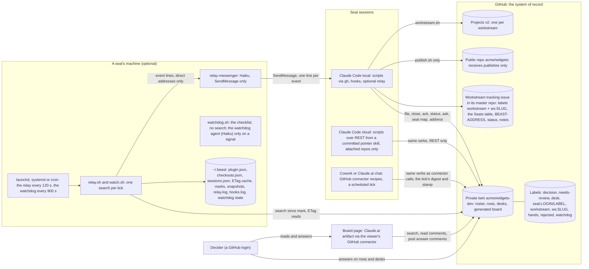

# Architecture

Beast has three parts: a protocol (shapes of GitHub objects and comments, `docs/protocol.md`), a plugin that applies it (`plugin/`), and GitHub, which is the only system of record. Everything else, the relay, the caches, the Cowork tick, the machine-local files under `~/.beast` and auto-memory, is an optimization that can be lost without losing a fact.

## 1. System context

- The decider answers in their own words: a comment on a row or desk, the board page (which posts the same comment through their connector), or words typed to a seat's session, which the seat quotes verbatim on the row (`docs/protocol.md`, Decisions).
- Seats on every surface read and write the same objects. Local seats use `gh` through `lib.sh::gh_get`, `gh_get_all` and `gh_send`; cloud seats run the same scripts against the sandbox's REST proxy (GraphQL is refused, so `lib.sh::project_cmd` dies naming it and `lib.sh::pin_issue` warns); Cowork and chat seats follow `plugin/skills/connector/SKILL.md`, and the decider's Cowork hears by a scheduled task running `plugin/skills/cowork-tick/SKILL.md`.
- The relay is one scheduled job per machine (`install-relay.sh`, run from the recorded plugin root). It searches GitHub once per tick and only when something changed starts a disposable Haiku session that can do nothing but `SendMessage` (`relay.sh`, `plugin/agents/relay-messenger.md`); it sends only to a seat whose recorded address is direct from this machine (`seats.sh address`). A seat it cannot reach loses nothing: its inbox is computed from GitHub (`decision.sh inbox`). An address it could not reach twice is not sent to again until the seat records a new one; a GitHub rate limit is named once and backed off.
- The machine watchdog is a second job on the same machine (`install-relay.sh --job watchdog`, every 900 s). Its shell checklist (`watchdog.sh`) runs with no model and no search; it re-points a mispointed relay, files measured defects on the plugin twin (labelled `watchdog`, deduplicated by listing), re-stamps a live seat's renamed or stale address with the live name of its claimed session (`seats.sh touch`, from Claude Code's session file), and starts its Haiku agent (`plugin/agents/watchdog.md`; tools Bash, Read, SendMessage, ListAgents) only for a finding that needs `SendMessage`: a tagged reminder (`BEAST-WATCHDOG to=…`) of an unacked row, for one. Under its session every plugin script but `watchdog.sh` and the hooks refuses to run (`lib.sh::watchdog_guard`).
- The private twin holds all work and coordination; the public repo receives only what `publish.sh` writes (`publish.sh::public_push`, `publish.sh::public_send`). `lib.sh::coord_write_guard` refuses every coordination write to a public or public-intended repo, the `## Seats` table and the master's CLAUDE.md block included.

## 2. Roles, identities, seats and workstreams

Four words, each with one owner.

| Word | Is | Owner |
|---|---|---|
| **Role** | what a seat is obliged to do and how it works: an agent file. The plugin's generic `daita-beast:seat` (`plugin/agents/seat.md`) is the orchestrator role, whose body points at the home's Beast block as the owner of the obligations; a repo's own `.claude/agents/<name>.md` specializes it with its domain and one line `Seat role: daita-beast:seat` | the agent file (`lib.sh::seat_agent_path` finds it: the plugin's `agents/` for `daita-beast:<name>`, else the seat repo's `.claude/agents/<name>.md` in a local checkout or through the contents API; it dies naming the file that does not exist) |
| **Identity** | one role held by one GitHub login under a label in one workstream: `<slug>/<LABEL>/<login>` (`lib.sh::SEAT_IDENTITY_RE`). Inside one workstream's own artifacts the short id `<login>/<LABEL>` abbreviates it (row labels `seat:<login>/<LABEL>`, acks, status headers, close comments, the `## Seats` table). The same login and label in two workstreams are two identities | derived, never stored: `lib.sh::seat_identity_of` from the roster row's `github`, `label` and `workstream`; `lib.sh::seat_short` and `seat_identity` convert between the forms; `lib.sh::seat_id` resolves a bare LABEL through this repo's roster, then every open workstream's table (`ws_seats_all`), to exactly one seat |
| **Seat** | the identity as rostered and homed: its row in `<repo>/.beast/roster.json` (`github`, `label`, `repo`, `agent`, `workstream`, `home`, optional `lane` and `retired`), its home directory on a machine, its `BEAST-ADDRESS` comment, its `BEAST-STATUS` and `BEAST-NOTES` comments | the roster row (`lib.sh::roster_check_unique` is the one check: `repo` equals the roster's own, so a peer row is refused; `agent` and `workstream` required; `role` and `tracking` refused naming the key) |
| **Workstream** | a slug, its id. One Projects v2 board plus one tracking issue labelled `workstream` and `ws:<slug>`; exactly one open issue carries both among the workstream owners (the roster's owners plus its declared `workstream_owners`, `lib.sh::workstream_user_terms`), re-read live after the search (`lib.sh::workstream_candidates`, `workstream_issue`; 0 or 2+ dies naming them). Its **master** is that issue's repo (`lib.sh::workstream_master`), derived, never stored. Its **seat map** is the issue's `## Seats` table | the tracking issue |

The seat map is where the words meet: one table on the tracking issue, `| Seat | Repo | Home | Agent | Account | Address | Seen |`, parsed by one parser by shape (`lib.sh::ws_seats_table_parse`: the first four cells define a seat and every line that is not a row of that shape dies naming the line) and written by one renderer (`lib.sh::ws_seats_render`, through `ws_seats_write` behind the guard). The last three cells are rendered from each seat's `BEAST-ADDRESS` comment on the same issue (`lib.sh::seat_addresses_of`) and ignored by the parser, so a hand edit of an address edits nothing. No roster indexes another repo's seats: `lib.sh::ws_seats_all` (every open workstream's table across the roster's owners) is the one enumeration of all seats, read by `seats.sh list`, `resume.sh` and the bare-label fallback.

A seat's **address** (its `SendMessage` name, its Claude account, its machine, the time) is a fact of the seat on GitHub, not of a machine: one `BEAST-ADDRESS` comment per seat on its tracking issue, created once and edited in place (`seats.sh record`, `seats.sh touch`; `lib.sh::address_header`, `seat_address_read`), with `~/.beast/sessions.json` a machine-local cache keyed by the identity. The address is the session's name, as Claude Code's own session file `~/.claude/sessions/<pid>.json` states it (`lib.sh::claude_session_of`, the one reader), optionally with the ` [ref]` ListAgents prints (`lib.sh::ADDRESS_RE`); `join.sh` records it, so the SessionStart rejoin does, and the watchdog re-stamps it when the session's name changed. The SessionStart hook prints the recorded address with its age; `seats.sh address` reads the comment live and says which path applies: **direct** (`SendMessage`, only when the reader runs as the same Claude account on the same machine and the address is fresh, `lib.sh::ADDRESS_FRESH_S`, 24 h) or **desk** (`desk.sh msg`). Every seat-to-seat line, direct or on a desk, opens with the one tag `BEAST-MSG from=<identity> to=<identity> re=<ref|none> blocking=no at=<UTC>` (`lib.sh::MSG_HEADER_RE`, written by `msg_header`, read by `desk_parse` and the board page's twin).

## 3. Components

```mermaid
flowchart TB
  subgraph LIB["lib.sh: the one owner of shared logic"]
    L1["GitHub I/O: gh_request, gh_get, gh_get_all, gh_send, row_read, search_issues, issues_list_shows, contents_path, default_branch, gh_status_of"]
    L2["Identity and homes: seat_id, seat_identity, seat_short, seat_locate, seat_home_path, seat_agent_path, roster_check_unique"]
    L3["Workstreams: workstream_issue, workstream_master, ws_seats_table_parse, ws_seats_render, ws_seats_write, ws_seats_all"]
    L4["Addresses and tags: address_header, seat_address_read, msg_header, MSG_HEADER_RE, BOOKKEEPING_FIRST_LINE_RE"]
    L5["Blocks: claude_block_render, block_replace, block_write, ws_block_render, ws_block_write_local, ws_block_write_remote"]
    L6["Queue: answer_kind, row_phrase, row_events, seat_acks, row_close_comment, row_close, close_of, latitude_record, row_after_close, row_answer_url, ask_inline_check"]
    L7["Privacy: repo_public_why, roster_pair_check, coord_write_guard"]
    L8["Scrub and license: roster_scrub, scrub_patterns, scrub_scan, roster_license, WORDS_*"]
    L9["Desks, deps, milestones: ask_header, desk_parse, waits_on_*, milestone_*, dep_state, deps_declared"]
    L10["Machine: plugin_root, plugin_root_record, vscode_workspace_folders, beast_checkouts, checkouts_record"]
  end

  subgraph SEAT["Seating and memory"]
    S1[seat.sh]
    S2[join.sh]
    S3[seats.sh]
    S4[resume.sh]
    S5[notes.sh]
    S6[status.sh]
  end

  subgraph QUEUE["The board and the desks"]
    Q1[decision.sh]
    Q2[pr.sh]
    Q3[ack.sh]
    Q4[desk.sh]
    Q5[board.sh]
    Q6[relabel.sh]
  end

  subgraph WATCH["Hearing"]
    W1[watch.sh]
    W2[relay.sh]
    W3[install-relay.sh]
    W4[watchdog.sh]
  end

  subgraph PLAN["Workstreams and scheduling"]
    P1[workstream.sh]
    P2[milestone.sh]
    P3[deps.sh]
    P4[report.sh]
  end

  subgraph PUB["Public side and cleanup"]
    U1[publish.sh]
    U2[license.sh]
    U3[wrapup.sh]
    U4["realign/*.sh"]
    U5["pandoc/latex-crossrefs.lua"]
  end

  subgraph SETUP["Setup and awards"]
    T1[bootstrap.sh]
    T2[init-repo.sh]
    T3[permissions.sh]
    T4[award.sh]
    T5[bounty.sh]
    T6[ledger.sh]
  end

  subgraph HOOKS["hooks.json"]
    H1["PreToolUse: permit.sh"]
    H2["SessionStart: seat-hello.sh"]
    H4["SessionEnd: seat-bye.sh"]
  end

  subgraph AG["Agents"]
    A0["seat (the generic role)"]
    A1["relay-messenger (Haiku)"]
    A2[relay-installer]
    A7["watchdog (Haiku)"]
    A3[seat-clerk]
    A4[license-reviewer]
    A5[moderator]
    A6[reporter]
  end

  subgraph TPL["Templates"]
    X1[claude-block.md]
    X2[workstream-block.md]
    X3["board.html (first line: the commit stamp)"]
    X4[roster.example.json]
    X5[labels.json]
    X6[cloud-skill.md]
    X7["decision.md, workstream.md, bounty.md, award-policy.md"]
  end

  SK["Skills: one per verb, plus install, connector, cowork-tick, board-ui, realign"]

  SEAT --> LIB
  QUEUE --> LIB
  WATCH --> LIB
  PLAN --> LIB
  PUB --> LIB
  SETUP --> LIB
  H1 --> L10
  H2 --> LIB
  H4 --> LIB
  W2 --> A1
  S2 --> X1
  S1 --> P1
  P1 --> X2
  T2 --> X5
  T2 --> X7
  T1 --> X6
  U2 --> U5
  SK --> SEAT
  SK --> QUEUE
  SK --> PUB
  X3 -. "regex-mirror test" .- L4
```

- Every script sources `lib.sh` and calls GitHub only through it; `lib.sh::gh_request` is the one HTTP GET (conditional on the ETag cache), `lib.sh::gh_send_try` the one write. `publish.sh` adds two writers that wrap them for the public repo only; `lib.sh::ws_block_write_remote` writes a master's CLAUDE.md through the contents API with the sha read first (a file that moved is a 409, exit 1, nothing written).
- Each script parses its inputs by shape and exits non-zero naming what it could not read (README, "Every script parses by shape").
- Agents decide nothing on GitHub's state: the `seat` agent is a role whose obligations live in the block, the messenger only sends, the clerk and the license reviewer only read and draft, the moderator posts one draft comment per item.
- The board page is a template (`plugin/templates/board.html`) whose parsers are JS twins of `lib.sh`'s regexes; `plugin/tests/regex-mirror.test.mjs` fails when they read a line differently. `plugin/tests/seats-model.test.mjs` runs the seat model's parsers and identity forms through bash with no network.
- The plugin's scripts are found by one function on a machine, `lib.sh::plugin_root` (`$CLAUDE_PLUGIN_ROOT`, else the root `~/.beast/plugin.json` records, written once by `plugin_root_record`): the hooks, the relay job and `install-relay.sh` consume it, so no committed file names a machine path.

## 4. Where state lives

One owner per fact. Every other place that shows a fact is a rendered copy of it, regenerated from the owner and never edited by hand. "Never" names places where the fact must not be kept.

| Fact | Owner (shape) | Rendered copies | Never |
|---|---|---|---|
| A seat's role | the agent file the roster row's `agent` names (`lib.sh::seat_agent_path`) | `join.sh`'s `role:` line; the block's "Your role" line; the `Agent` cell of the seat map | a session's context; prose in the roster |
| A seat exists: login, label, repo, agent, workstream, home kind, optional lane | its row in `<repo>/.beast/roster.json`, the roster's own repo only (`lib.sh::roster_check_unique`) | none: a roster is not copied | a peer row in another repo's roster |
| A seat's identity | derived: `<slug>/<LABEL>/<login>` from the row (`lib.sh::seat_identity_of`) | every place that names the seat | stored as a field |
| Which seats are in a workstream, with repo, home and agent | the `## Seats` table of the workstream's tracking issue (`lib.sh::ws_seats_table_parse`, `ws_seats_write`; `workstream.sh seat-add|seat-remove`) | the master's CLAUDE.md block (`workstream.sh render`); every home's Beast block (`join.sh`); `seats.sh list`; `resume.sh` | a roster that lists other repos' seats; a hand edit of a block |
| The master of a workstream | derived: the repo of the tracking issue (`lib.sh::workstream_master`) | the issue's `## Master repo` section; the blocks | stored by number or name |
| Which issue tracks a workstream | derived: the one open issue with the labels `workstream` and `ws:<slug>` (`lib.sh::workstream_issue`) | the blocks' tracking links | an issue number in the roster |
| A seat's address and Claude account | its one `BEAST-ADDRESS` comment on its tracking issue (`seats.sh record`, `seats.sh touch`, `lib.sh::address_header`); the name in it is read from `~/.claude/sessions/<pid>.json` (`lib.sh::claude_session_of`) | the Account, Address and Seen cells of the seat map; `~/.beast/sessions.json` (machine-local cache, keyed by the identity); `seats.sh list` | the roster; a hand-edited cell (the parser ignores it) |
| A pending decision (an act without code) | issue labelled `decision`, six `##` sections, assignee the decider, `seat:<id>` labels (`decision.sh new`) | the generated board; the board page | a chat message or a session's context |
| A code change awaiting the decider | the PR, labelled `needs-review` and `seat:<id>`, assigned (`pr.sh request`) | the board | a review request (refused while seats post as the PR author's login) |
| The decider's answer | their comment on the row in one of four forms (`lib.sh::answer_kind`), or words typed to a session quoted in the close comment | the decided table | a paraphrase anywhere |
| A close | the close comment (`lib.sh::row_close_comment`, read by `close_of` against `CLOSE_LINE_RE`): the words verbatim, the record, the closer, the closer's ack; or, under a seat's standing latitude, no words and the record's link in the close line (kind `latitude`) | the decided table | an edited body |
| A seat's consumption of a row or desk | its newest `BEAST-ACK seat=<id> …` comment (`ack.sh`, read by `lib.sh::seat_acks`) | the board's per-seat ack state | a local watermark |
| A seat's inbox | computed: rows whose latest event (`lib.sh::row_events`) is newer than the seat's newest ack, then its desk (`decision.sh inbox`) | none | stored anywhere |
| A desk ask, answer, withdrawal, message | comments on the seat's desk issue (`desk.sh`, parsed by `lib.sh::desk_parse`) | the desk body (`desk.sh publish`); the page's desk strip | the body as a source |
| A seat-to-seat line | the `BEAST-MSG` tag line plus body (`lib.sh::msg_header`): a direct `SendMessage` on a direct path, else the durable copy on the recipient's desk (`desk.sh msg`) | the desk body | the board |
| A seat's working state | its newest `BEAST-STATUS … state=handoff` comment on its tracking issue (`status.sh`, read by `resume.sh`) | none | auto-memory |
| What a seat must not relearn | its one `BEAST-NOTES seat=<id>` comment, edited in place (`notes.sh`) | none | auto-memory, a second notes comment |
| The twin pair, scrub and license settings, people | `.beast/roster.json` in the main checkout, committed | none | a worktree's copy of the roster |
| A seat's home path | derived from the roster's `home` by `lib.sh::seat_home_path`; the home carries `.beast/seat.json` (`{"id","kind"}`) | `seat.sh where`; the hook's context line | stored as a path in the roster |
| The plugin's scripts path on a machine | `~/.beast/plugin.json` `{root, version, recorded_at}` (`lib.sh::plugin_root_record`; `$CLAUDE_PLUGIN_ROOT` wins while a plugin runs) | the hook's `scripts:` line; the relay job | a committed file |
| Which checkouts exist on this machine | `~/.beast/checkouts.json` (`lib.sh::checkouts_record`) | none | the roster |
| A read's ETag and body | `~/.beast/cache/<login>/` (`lib.sh::gh_request`); every read still asks GitHub | none | trusted without asking GitHub |
| The relay's position | `~/.beast/watch/<login>/<LABEL>.mark` and `.json` (`watch.sh`); its rate-limit backoff `~/.beast/watch/backoff` and fault ledger `~/.beast/watch/faults.json`; its unreachable ledger `~/.beast/relay-unreachable.json` (`relay.sh`) | none | the contract (the inbox is) |
| A hook's block or fault | one line in `~/.beast/hooks.log` (`lib.sh::hook_log`) | the watchdog's bug on the twin | the session's context alone |
| What the machine watchdog learned | one `BEAST-WATCHDOG-NOTES machine=<host>` comment on the Beast workstream's tracking issue, edited in place (`watchdog.sh`); its offsets, ledgers and row cache in `~/.beast/watchdog/state.json`, a cache | the agent's memory digest | its own instructions (the catalogue `plugin/watchdog/gotchas.md` changes by a commit) |
| The Cowork tick's cut | the viewer's one `BEAST-COWORK by=<login> at=<UTC> …` comment on the pinned board issue (`cowork-tick`), bookkeeping, never news | none | a second stamp per login |
| Which template a board page was published from | the page's first line `<!-- board.html @ <sha> -->`, filled by `board-ui` at publish from the template's stamp line | none | a page edited apart from the template |
| A milestone and its due date | GitHub milestone; `due_on` is the only copy of the date; the description's fixed lines (`lib.sh::milestone_desc`) | the inbox's due flags | a date in prose |
| A dependency | one `Waits on: <ref>` line (`lib.sh::waits_on_line`) in a row, an ask or a milestone description | `deps.sh` | a list kept elsewhere |
| The decider's board | the generated issue "Pending decisions (generated)" in the roster's `board` repo (`board.sh --publish`), and the live search | the board page | hand edits |
| Rules a seat follows in a home | the block between `<!-- beast:begin -->` and `<!-- beast:end -->` in the home's CLAUDE.md, rendered by `lib.sh::claude_block_write` from `templates/claude-block.md` for that seat | none: the block is itself a rendering of the roster, the agent file and the seat map | hand edits (the next join undoes them) |
| A workstream's map in its master | the block between `<!-- beast:workstream begin <slug> -->` and `end` in the master's CLAUDE.md (`lib.sh::ws_block_write_local`, `ws_block_write_remote` from `templates/workstream-block.md`) | none: itself a rendering of the table | hand edits (the next render undoes them) |
| Awards | `BEAST-AWARD` comments by a repo admin or maintainer plus the `awarded` label; monthly roll-up `awards/<YYYY-MM>.jsonl` (`ledger.sh`) | the participant report | a second ledger |
| A wrap-up plan | `.beast/wrapup/<slug>/plan.json`, committed, linked with its digest from the wrap-up row (`wrapup.sh request`) | none | applied without the row's approval |
| Lessons true for every seat started in one folder | auto-memory of the launch folder | none | one seat's state |

## 5. Surfaces

The protocol is the same on every surface; what differs is how GitHub is reached, what can run, and how a decision is heard. The `install` skill detects the surface from evidence and walks only that surface's numbered checklist, each step with its gate and the evidence to quote.

| | Claude Code, local (terminal or VS Code) | Claude Code, cloud | Cowork / Claude.ai chat |
|---|---|---|---|
| Install | marketplace plugin, then `/daita-beast:install`: tools, the install gate, `permissions.sh` (the repo's `.claude/settings.json`), `plugin_root_record` (`~/.beast/plugin.json`), bootstrap, workstream, seat, join, relay, fixture | nothing installs: the repo's committed `.claude/skills/beast/SKILL.md` (from `templates/cloud-skill.md`) clones the plugin and runs its scripts | Customize › Plugins; the `connector` skill is the protocol as connector calls; `board-ui` publishes the page; a scheduled task runs `cowork-tick` |
| GitHub | `gh` as the person | the sandbox proxy, REST only, attached repos only | the GitHub connector, installed per account |
| Permissions | `permissions.allow` rules for `gh` and git read verbs in the repo's `.claude/settings.json`; the plugin's scripts by the PreToolUse hook | the session's own | the connector's consent |
| Hears a decision | the relay, on direct addresses only | pulls: the inbox at every wake | a seat pulls the inbox recipe; the decider's tick posts a digest and republishes the page |
| Seats and addresses | `join.sh` records the address, the session's name from its Claude Code session file | no session file: the seat works from its inbox; no address is recorded | no `ListAgents` and no shell: the seat map is read from the table, a seat here is reached by its desk |
| Scripts path | `lib.sh::plugin_root` | the pointer skill's clone | none |

In VS Code one window holds several repos: every session starts in the launch folder, the SessionStart hook lists the seats of every workspace file that lists the launch folder (found walking up to `$HOME`, in any position: `lib.sh::vscode_workspace_folders`), and seating sets the root. Any number of seats share a launch folder; two seats never share a home.
