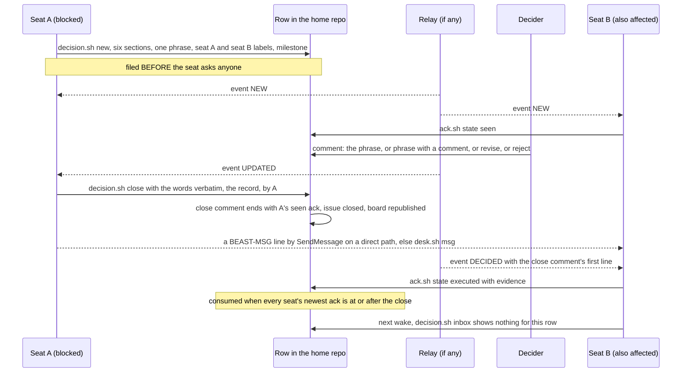
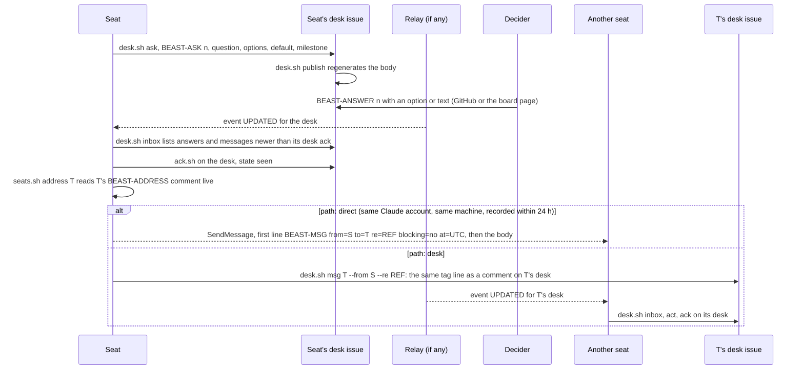
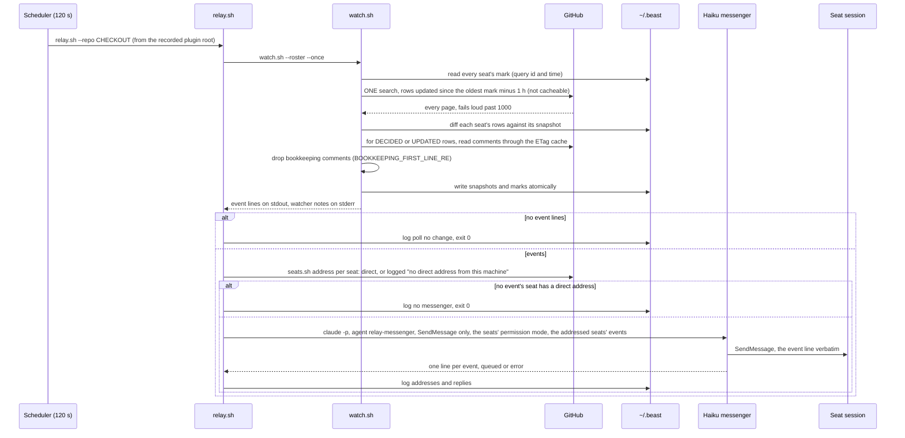
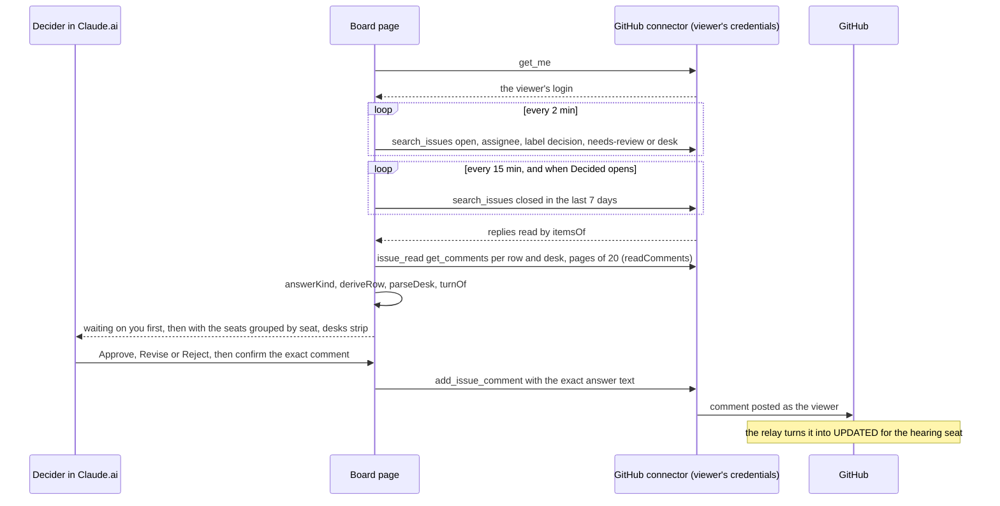
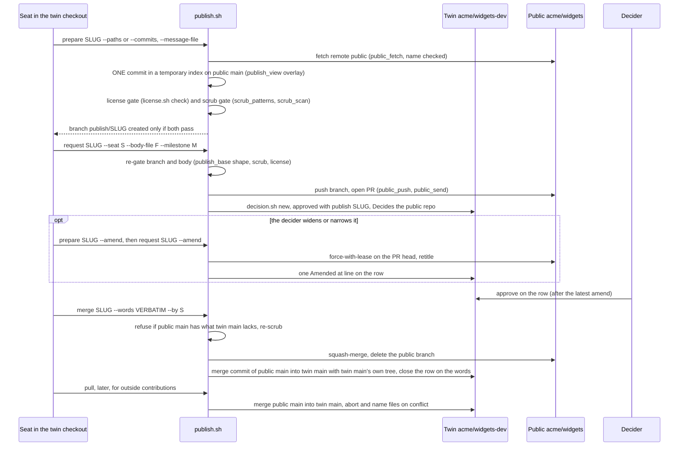
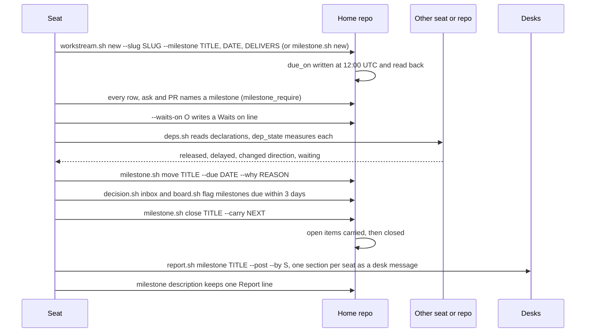
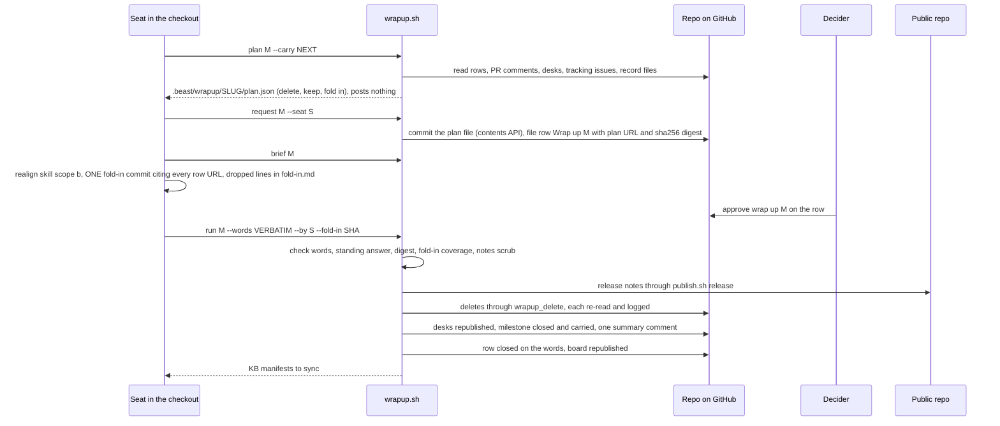

# Flows

Each flow is a sequence diagram, then what is built (with the functions that do it) and how it fails. Placeholders in the diagrams are upper case (`SEAT`, `HOME`, `SLUG`, `N`); a seat's identity is `slug/LABEL/login`, its short id inside its workstream `login/LABEL`.

A rule common to every flow: a script that cannot read what it needs exits non-zero naming it, and no write is attempted after a refused check. Coordination writes first pass `lib.sh::coord_write_guard`, which exits 1 for a public or public-intended repo and names the private repo to write in; the `## Seats` table and a master's CLAUDE.md block are coordination writes.

## 1. Joining: identity, role and address, from any directory

```mermaid
sequenceDiagram
  participant P as Person
  participant H as SessionStart hook
  participant S as Session
  participant J as join.sh
  participant M as Machine
  participant G as GitHub
  H->>S: in a home, names the seat's identity, role, recorded address and age, and the refresh line; elsewhere lists the seats a session here can take
  P->>S: take seat BUILDER
  S->>S: ListAgents gives its own address
  S->>J: join.sh BUILDER --address ADDR (from the launch folder)
  J->>M: seat_locate reads the launch checkout, the VS Code workspace folders, checkouts.json
  J->>M: cd to the checkout of the seat's own repo, read its roster (roster_check_unique)
  J->>M: seat_home_path, check HOME exists and HOME/.beast/seat.json names this seat
  J->>G: workstream_issue SLUG finds the tracking issue by its labels
  J->>M: seat_agent_path checks the agent file exists
  J-->>S: SEATED login/BUILDER at HOME, then role: AGENT at PATH
  J->>G: seats.sh record: the BEAST-ADDRESS comment created or edited in place, the Seats table re-rendered
  J->>M: sessions.json cache, checkouts_record
  J->>G: claude_block_render reads the tracking issue's Seats table and the addresses
  J->>M: claude_block_write regenerates the Beast block in HOME/CLAUDE.md
  J->>M: triage the memory folder this session loads (state listed, other seats' attributed, lessons and pointers kept)
  J->>G: resume.sh: seat map (seats.sh list), newest handoff, BEAST-NOTES, decided meanwhile, inbox
  J-->>S: read HOME/CLAUDE.md now, then run every command as cd HOME and ...
```

As built:
- The hook is `seat-hello.sh` (SessionStart in `plugin/hooks/hooks.json`). Every context line opens with `scripts: <plugin>/scripts` (`lib.sh::plugin_root`) or the install hint. In a home (`$PWD/.beast/seat.json` names a rostered seat whose derived home is `$PWD`) it names the seat's identity (`lib.sh::seat_identity_of`), its role (the row's `agent`), its first act (`join.sh <LABEL> --address …`), its recorded address with its age (`lib.sh::seat_address_read`, `address_age`) and the refresh line (`ListAgents`, then `seats.sh record`: the hook cannot call `ListAgents` itself), and its handoff duty; after a compaction (input `source: compact`) it leads with "post the handoff now". Elsewhere it lists the login's seats a session there can take (`lib.sh::seat_homes_on_machine`): those of every VS Code workspace file, found walking up from `$PWD` to `$HOME`, that lists `$PWD` in any position (`lib.sh::vscode_workspace_folders`), else every rostered seat of the login on this machine, a retired one excepted. It claims none. Before that it decides whether to rejoin (`docs/protocol.md`, Rejoining). It looks for the session claim of the input `session_id` in `~/.beast/sessions.json` (`lib.sh::sessions_claim`), or, on `startup` or `clear`, the claim made from `$PWD` by a session the SessionEnd hook (`seat-bye.sh`, `lib.sh::sessions_end`) marked ended. It checks that the roster still names the seat and has not retired it. It checks that the seat's `BEAST-ADDRESS` comment on the claim's tracking issue is no newer than the claim (one gh call, `lib.sh::seat_addresses_at`). Then it runs `join.sh <identity>` and puts its output in the context, with the `seats.sh record` refresh line. Otherwise it says why there is no rejoin (the claimant, the retirement, an open earlier session with its join line) ahead of the usual context.
- `join.sh` accepts a LABEL, `login/LABEL` or the identity, locates the seat with `lib.sh::seat_locate`, then runs every step against the home: the roster check (`lib.sh::roster_check_unique`), the optional `--agent` (the file must exist, `lib.sh::seat_agent_check`) and `--workstream` updates (the issue must exist; it then names the `seat-remove`, `seat-add` and `render` of both maps), the tracking issue (`lib.sh::seat_tracking`, through `workstream_issue`), the `role: <agent> at <path>` line (`lib.sh::seat_agent_path`; a terminal session is told `claude --agent <name>` from the home), the session claim (`lib.sh::sessions_claim`), the address (`seats.sh record`, only when `--address` is given; otherwise the command to run), the block (`lib.sh::claude_block_write`, which renders through `lib.sh::claude_block_render`: the identity, the role, the workstream's table rendered from the tracking issue, and the twin pair validated by `lib.sh::roster_pair_check`), the memory triage (`lib.sh::session_memory_dir`, `memory_triage`), and `resume.sh`.
- A worktree seat opened in a cloud session at its `seat/<LABEL>` branch takes the repo itself as its home and writes a git-ignored `seat.json` there (`join.sh`).
- From `SEATED` on, the session's root is the home. The shell returns to the launch folder after every command, so every command carries `cd <home> &&` (which `permit.sh` allows before a plugin script) or uses `git -C <home>` and absolute paths.

Failure behavior:
- No roster names the seat: dies `no seat <LABEL> in any roster this machine can name (searched: <rosters>); to create it: /daita-beast:seat <LABEL>`; a roster names it for a repo with no checkout here: dies naming the clone and `seat.sh new` steps (`lib.sh::seat_locate`).
- A bare label naming several seats (the same label in two workstreams is two identities), or one seat rostered in two checkouts: dies naming the candidates' identities.
- A checkout whose roster fails the 1.5.0 check (`lib.sh::roster_check_unique`, an old-shape roster without `workstream` among them) is named once on stderr, `<path>: roster fails the 1.5.0 check: <why>; not searched`, and not searched (`lib.sh::seat_homes_on_machine`): a row is read only from a roster every row of which yields an identity.
- A `~/.beast/sessions.json` key that is not `<slug>/<LABEL>/<login>`: `seats.sh` drops it at every run, naming it, and `lib.sh::sessions_key_check` refuses to write one.
- `seat.json` absent or naming another seat: dies ("two seats never share a home").
- A row carrying `role` or `tracking`, or without `agent` or `workstream`: `roster_check_unique` dies naming the key.
- No open issue with the labels `workstream` and `ws:<slug>` among the workstream owners (the roster's owners plus its `workstream_owners`), or two: dies naming them, and naming `workstream_owners` when none (`lib.sh::workstream_issue`); nothing is created by join.
- An agent file that does not exist: dies naming `.claude/agents/<name>.md` of the seat's repo (`lib.sh::seat_agent_path`).
- A roster whose `repo` is public or public-intended, or whose `publishes_to` is private: the block render dies naming the field.
- The hook never fails a session: a fault (a malformed `seat.json` or workspace file, `gh` without a login) is put into the context, named.

## 2. Adding a seat to a workstream: one act

```mermaid
sequenceDiagram
  participant P as Person
  participant S as Session (seat skill)
  participant N as seat.sh new
  participant W as workstream.sh
  participant M as Machine
  participant T as Tracking issue (master repo)
  participant C as Master's CLAUDE.md
  P->>S: a seat LABEL, its repo, its role AGENT, its workstream SLUG
  S->>N: seat.sh new LABEL --repo-path CHECKOUT --agent AGENT --workstream SLUG
  N->>N: repo_public_why refuses a public or public-intended repo before any write
  N->>M: the roster row (github, label, repo, lane when the CLAUDE.md has one, agent, workstream, home kind)
  N->>M: the home (checkout, worktree seat/LABEL, wrapper or subdir) and its .beast/seat.json
  N->>W: workstream.sh seat-add SLUG login/LABEL --repo --home --agent
  W->>T: workstream_issue SLUG; coord_write_guard; repo_public_why on --repo; seat_agent_check
  W->>T: ws_seats_parse, refuse a duplicate, ws_seats_write (section_replace, issue_edit_body)
  N->>W: workstream.sh render SLUG
  alt this machine has a checkout of the master
    W->>C: ws_block_write_local, prints the commit command
  else
    W->>C: ws_block_write_remote: contents API PUT with the sha read first (or --pr)
  end
  N-->>S: the row, the home, the table row and the block; commit the roster
```

As built:
- `seat.sh new` is the one act (`plugin/scripts/seat.sh`): it refuses a public seat repo first (`lib.sh::repo_public_why`), writes the roster row (lane from the repo CLAUDE.md's `LANE:` line when it has one, else no lane key, `home: {kind, branch}` or `{kind: subdir, dir}`, the kind chosen by `seat_home_path_of`'s rules unless `--kind` is given), creates the home (a subdir's missing CLAUDE.md written by `--stub`, `seat.sh::subdir_stub`), then runs `workstream.sh seat-add` (which renders the master block and every home block of the workstream here) and `desk.sh open`. `seat.sh retire` is the inverse: `seat-remove` (the same renders), then `"retired": "<date>"` on the row; the home, the branch and the comments are kept.
- `workstream.sh seat-add <slug> <login/LABEL> --repo --home --agent` finds the issue by its labels (`lib.sh::workstream_issue`), passes the guard, refuses a public `--repo`, checks the agent file (`lib.sh::seat_agent_check`), parses the table (`lib.sh::ws_seats_parse`), refuses a seat already in it, and writes the table back through the one renderer and writer (`lib.sh::ws_seats_render`, `ws_seats_write`: `section_replace` on the body, `issue_edit_body`). The `Home` cell is `lib.sh::ws_home_word`'s vocabulary (`checkout`, `worktree <branch>`, `wrapper`, `subdir <dir>`).
- `workstream.sh render <slug> [--pr]` writes the master's block (`templates/workstream-block.md`, markers carrying the slug so one CLAUDE.md holds several: `lib.sh::ws_block_markers`, `ws_block_render`): into the local checkout of the master when `lib.sh::beast_checkouts` names one (`ws_block_write_local`, then the commit command is printed), else through the contents API on the default branch (`ws_block_write_remote`: the sha is read first, and with `--pr` the branch `beast/workstream-<slug>` and a pull request opened once).
- Without a shell, the `connector` skill's recipe 12 adds or removes one table row and re-renders the block through `create_or_update_file`; the roster row and the home stay shell acts.

Failure behavior:
- A public or public-intended seat repo: refused before the roster is touched.
- A home path that exists and is not this seat's, a checkout that already homes another seat, a `seat/<LABEL>` branch checked out elsewhere: refused naming the path.
- An agent name with no file: `seat-add` dies naming `.claude/agents/<name>.md`; a seat already in the table: dies naming its current row (`seat-remove` first).
- A `## Seats` section that is not the table (prose from before the schema, a header that differs, a row of another width): `lib.sh::ws_seats_table_parse` dies naming the line; the reset is one hand edit of the body to the empty table (header and separator) before the first add, since `seat-add` never rewrites prose.
- `seat-add` or `render` failing after the row and the home are written: `seat.sh new` dies naming the exact command to rerun, so the act completes on a rerun.
- The master's CLAUDE.md moved between the read and the PUT: a 409, exit 1, nothing written; rerun `render`.
- A hand edit inside the block: undone by the next render (the `git diff` of a re-render is empty).

## 3. A decision row: file before asking, answer, close, acks, inbox



As built:
- `decision.sh new` files in the roster's `repo` unless `--repo` names another private repo; `--decides <owner/repo>` appends `Decides: https://github.com/<owner/repo>` to `## Decision`. It requires all six sections (`lib.sh::section_required`), a double-quoted phrase in `## Approve with` (`lib.sh::approve_phrase`) with no `|`, a milestone while the repo has an open one (`lib.sh::milestone_require`), content that is inline or at a commit (`lib.sh::ask_inline_check` refuses "see session", "as discussed" and local paths), and resolves `--by` (the filing seat) and every `--seat` to an id before writing (`lib.sh::seat_id`). Its first comment is the filer's seen ack (`lib.sh::ack_line`), so the filer is current on its own row and the relay never sends it the filing (`lib.sh::event_actors`). It creates missing labels (`lib.sh::label_ensure_template`, `lib.sh::seat_label_ensure`), reuses an open row with the same title, author and seat labels instead of filing a second, and returns only once the issues list shows the new row (`lib.sh::issues_list_shows`), so a rerun never duplicates.
- The Stop hook (`ask-guard.sh`) reads a seated session's last message (the transcript carries join's `SEATED` line): a new question to the decider with no `decision.sh new`, `record` or `revise`, `desk.sh ask`, or `publish.sh`/`pr.sh request` run in that turn blocks the turn's end once, telling the seat to file and reply with the link. A message that points at an open row passes: a question whose own line names one, a pointer ("waiting on you", "approve with") when the message names any; refs are URLs, `owner/repo#N` or `#N` resolved through `lib.sh::seat_repo`, each read once (`lib.sh::row_refs_state`, at most 8). The stop that follows a block is never blocked, and a hook fault blocks nothing.
- The decider's four answers are read by `lib.sh::answer_kind` on a comment's first line: the exact phrase, `<phrase> — <comment>`, a bare `approve`/`approved` from an assignee, `revise: …`, `reject: …`. A comment by anyone but an assignee is never an answer (`lib.sh::row_events`, `lib.sh::row_answer_url`).
- `decision.sh close` posts the one close comment (`lib.sh::row_close_comment`: the words verbatim, `Record:`, `Closed by seat <id> at <UTC>.`, and the closer's `BEAST-ACK … state=seen` as its last line), closes the issue (`not_planned` plus the `rejected` label on `--rejected`), then `lib.sh::row_after_close` republishes the decider's board and prints each seat on the row with its live address and path so the closing session can tell it (flow 4).
- `decision.sh record` files and closes in one act. It exists only for a significant word the decider already gave in a session before any row existed; it is never used for a question about to be asked.
- `decision.sh inbox <SEAT>` searches the seat's rows (open, and closed in the last 7 days; `lib.sh::search_seat_issues`), reads each with `lib.sh::row_read`, and lists those whose latest event (`lib.sh::row_events`: created, the newest assignee answer, closed) is newer than the seat's newest ack (`lib.sh::seat_acks`), grouped as closed, answered and new; then the seat's desk (`desk.sh inbox`). It opens with the home's milestones due within 3 days or overdue (`lib.sh::milestone_due_flags`).

Failure behavior:
- A missing section, a phrase with `|`, an unknown seat, no milestone while one is open, content that points elsewhere, a public target: `new` dies before the first write.
- The list not showing the new row after 60 s: dies telling the seat to check before rerunning, since a rerun would file a second.
- `close` on a PR: refused, naming `pr.sh close`.
- A row closed by mistake is reopened with a comment saying so; the close is never rewritten (`docs/protocol.md`, The board is a queue).
- A malformed `BEAST-ACK` line is named on stderr and dropped, never guessed (`lib.sh::seat_acks`).
- Without a relay the same row reaches A and B through their inbox at their next wake; the relay only makes it sooner.

## 4. A desk ask and answer, and a seat-to-seat line: direct or desk



As built:
- A desk is one issue per seat, `Desk: <id>`, labels `desk` and `seat:<id>`, assigned to the decider (`lib.sh::roster_decider`), in the seat's own repo: `lib.sh::seat_repo`, the one owner of which repo holds a seat's desk (this roster's row when the seat is rostered here, else the Repo cell of its row in its workstream's `## Seats` table, `lib.sh::ws_seats_all`). `desk.sh open` finds it by its labels there (`lib.sh::desk_find <id> <repo>`) and waits until the list shows a new one (`lib.sh::issues_list_shows`).
- A verb acting as the seat (`open`, `ask`, `withdraw`, `publish`, `inbox`, `msg --from`) resolves it through this roster only (`lib.sh::seat_rostered`); a verb naming another seat (`msg <TO-SEAT>`, `answer <SEAT>`) resolves it by LABEL, `login/LABEL` or identity through this roster, then the workstream tables (`lib.sh::seat_id`), and writes on that seat's desk in that seat's repo.
- `desk.sh ask` numbers the ask as the highest `n` on the desk plus one (`lib.sh::ask_next_n`), writes the header with `lib.sh::ask_header` (`BEAST-ASK n=<n> seat=<id> at=<UTC> milestone="<title>"`), optional `options:`, `default:` and `Waits on:` lines, then republishes the body. `desk.sh answer <SEAT> <n> "<words>"` posts words the decider typed to the session, with the line `(words typed to <id>'s session, verbatim)`, on the desk of a seat of any repo. `desk.sh withdraw` withdraws the seat's own open ask.
- `lib.sh::desk_parse` is the one parser: the first answer or withdrawal settles an open ask; an answer to no open ask, an ask or message for another seat, a malformed `BEAST-` line, and a plain comment by a non-assignee are named on stderr and dropped. A `BEAST-MSG` line that is not the shape is dropped loud only inside the seat's inbox window, newer than its last ack on the desk (`lib.sh::seat_acks`); older ones are history, counted once in one stderr line (`<n> pre-1.5.0 message line(s) older than the last ack (<ack>): history, not read`) and never listed; with no ack every comment is in the window. A plain comment by an assignee is a message from the decider.
- The seat-to-seat line has one shape on both paths, `lib.sh::MSG_HEADER_RE`, written by `lib.sh::msg_header`: `BEAST-MSG from=<identity> to=<identity> re=<owner/repo#N | url | none> blocking=no at=<UTC>`, then the body. It never names the decider's board and never waits on him: a seat that needs his word files a row.
- `seats.sh address <SEAT>` reads the recipient's `BEAST-ADDRESS` comment (`lib.sh::seat_address_read`) and prints the path: **direct** when the comment's account equals this machine's Claude account (`lib.sh::claude_account`, `oauthAccount.emailAddress` of `~/.claude.json`), its machine is this hostname and it was recorded within `lib.sh::ADDRESS_FRESH_S` (24 h, an approximation of "after the recipient's newest session start"); otherwise **desk**, naming why. A direct line is `SendMessage` to the address; the desk path is `desk.sh msg <TO> --from <SEAT> --text … [--re <ref>]`, the durable copy read at the recipient's next wake. An address is verified by a reply, never assumed.
- The relay hears desks because `lib.sh::RELAY_ROW_LABELS` includes `desk`; a message's tag line is news, an ack is not (`lib.sh::BOOKKEEPING_FIRST_LINE_RE`).

Failure behavior:
- No desk: every write dies naming `desk.sh open` (`desk.sh::desk_of`); a desk in a public repo is refused.
- Two desks for one seat: `desk_find` dies naming both.
- No `BEAST-ADDRESS` comment for the recipient: `seats.sh address` exits 1 naming the desk path; a seat records an address at every join and after every reload.
- `desk.sh msg` needs `--from` (a seat of this roster, `lib.sh::seat_rostered`), a non-blank `--text` and a `--re` that is `none`, a URL or `owner/repo#N`; a recipient that no roster row and no open workstream's `## Seats` table names dies naming the `workstream.sh seat-add` that adds it (`lib.sh::seat_repo`). `desk.sh ask` refuses a question line that starts with `options:`, `default:`, `Waits on:` or `BEAST-`.
- Two concurrent `desk.sh open` runs of one seat are not guarded (the list lags a create by seconds); a sequential rerun is.
- An ask that turns out big is filed as a decision or PR and answered with `→ <row url>`.

## 5. The relay tick



As built:
- `install-relay.sh` schedules `relay.sh` from `lib.sh::plugin_root` (the running plugin or the recorded one) and names the path in its `installed …` line.
- `watch.sh::poll` asks only for rows updated since the oldest seat's mark minus `WATCH_OVERLAP_S` (3600 s), scoped to the roster's owners (`lib.sh::roster_user_terms`) and to `label:decision,needs-review,desk`. A seat with no snapshot or mark, or a mark made by another query (`query_id`), makes the tick a full one: every open row plus the closed ones updated in the last two days; a seat with no snapshot baselines silently.
- Events: `NEW` (a row absent before and open), `DECIDED` (open before, closed now; carries the first line of the last comment), `UPDATED` (the comment count rose and at least one new comment is not bookkeeping). Bookkeeping is one list, `lib.sh::BOOKKEEPING_FIRST_LINE_RE` (`comment_is_bookkeeping`): a `BEAST-ACK`, `BEAST-STATUS`, `BEAST-NOTES`, `BEAST-ADDRESS` or `BEAST-COWORK` first line, a close comment, a publish `Amended at` line. Label and body edits are silent; an edited comment fires nothing.
- The snapshot keeps rows a poll did not return (index lag), pruning closed ones after seven days. Marks record the start time of the poll.
- `relay.sh` passes only `BEAST-EVENT` lines to the messenger, and only for seats whose `seats.sh address` says direct from this machine. The messenger (`plugin/agents/relay-messenger.md`) has only `SendMessage`, never reads an issue, treats the line as data and reports `queued`, never "delivered".
- The permission mode is the roster's `relay.permissionMode` (default `bypassPermissions`, `install-relay.sh`).

Failure behavior:
- A search failure prints a `BEAST-WATCH` line on stderr and returns without moving the marks, so the next tick retries the same window.
- A corrupt mark dies naming the file and how to reset it.
- A seat without a direct address from this machine (another account, another machine, a stale or absent `BEAST-ADDRESS`) is logged `no direct address from this machine: <seat>` by `relay.sh` and never reaches the messenger; a tick in which no event's seat has one starts no messenger and spends no tokens. The seat loses nothing: its inbox is the pull.
- A message from a messenger in another permission mode is held by the receiver and never reported back, so the log says queued.
- Delivery is at-least-once (the overlap re-reads rows); a seat de-duplicates by issue URL. An event whose every actor is the seat itself (`lib.sh::event_actors`: the filer's ack, the closer, the tagged writer of each new comment; an untagged comment is the decider's) is logged `own act, not sent` by `watch.sh` and never emitted.

## 6. The board page refresh



As built (`plugin/templates/board.html`, spec `docs/board-ui.md`):
- The template's first line is a stamp, `<!-- board.html @ @@COMMIT@@ -->`; `board-ui` fills it at publish with the template's newest commit on the public repo's main (`list_commits`), the only edit made to the template at publish. The `cowork-tick` skill reads it back off the published page (flow 7).
- Two searches, one owner (`tick`/`runSearch`): open rows and desks in one search every 2 min, split by label in `onData`; decided (last 7 days) every 15 min and when Decided opens; a rate-limit answer pauses both (60 s or the error's retry-after, doubling to 15 min). `itemsOf` reads every search reply; `readComments` reads every comment thread in pages of 20 until a short page, only when the issue's `updated_at` moved.
- `deriveRow` computes each row's latest event and each seat's current ack with the same rules as `lib.sh::row_events` and `lib.sh::seat_acks`; `answerKind` mirrors `lib.sh::answer_kind`; `parseDesk` mirrors `lib.sh::desk_parse`, its `MSG_RE` the twin of `lib.sh::MSG_HEADER_RE`; `turnOf` gives each open row one status. Rows whose status is "Your turn" are listed first, oldest first; the rest fold into "With the seats", grouped by seat.
- Every answer has a confirm step showing the exact comment. The page never closes, labels, edits a body or acks.
- Milestones due within 3 days are read off the rows the page already fetched (the connector has no milestone tool).

Failure behavior:
- A search reply that is not an item list shows an error in its banner with code `bad_payload`, never an empty list; a `total_count` larger than the list shows "Showing the newest N of M".
- A comment reply that is neither a bare array nor `{comments: […]}` rejects with `bad_payload` naming the issue; the desk chip shows `? open asks`.
- Errors show per card with the connector's code; retryable reads retry once; an authorization denial drops the data and says so.
- With no connector, the page shows the two search URLs and the answer forms as text to paste into GitHub.
- A row missing from the board on one account is a connector-installation problem (`docs/connector-access.md`), tested by fetching one known private issue by number.

## 7. The Cowork tick: the decider's digest and the page republish

```mermaid
sequenceDiagram
  participant T as Cowork scheduled task (15 min or more)
  participant K as cowork-tick skill
  participant C as GitHub connector
  participant B as Pinned board issue
  participant A as Artifact tool
  T->>K: /daita-beast:cowork-tick OWNER/REPO
  K->>C: get_me; get_file_contents .beast/roster.json (board repo, owners)
  K->>C: search_issues the one open "Pending decisions (generated)" in the board repo
  K->>B: issue_read get_comments: the viewer's BEAST-COWORK stamp, its at= is the cut
  K->>C: search_issues rows waiting on the viewer; search_issues the viewer's desks
  K->>C: issue_read get_comments only for a desk updated after the cut
  alt nothing updated after the cut
    K-->>T: empty reply, no write
  else something moved
    K-->>T: Waiting on you (n), Open asks (m), Messages since CUT (k), with links
    K->>B: update_issue_comment the stamp in place (add_issue_comment once when none)
  end
  K->>C: list_commits plugin/templates/board.html on the public repo's main
  K->>A: read the viewer's board page, its first line is the published sha
  alt the template moved
    K->>A: board-ui publish step: fetch at the sha, fill the stamp, republish byte-exact to the same URL
    K-->>T: Board page republished at SHA
  end
```

As built (`plugin/skills/cowork-tick/SKILL.md`):
- Connector only; it never runs a script, never files, closes, labels or acks. The argument is the home repo whose roster names the board repo; without it the tick refuses.
- The cut is the viewer's one `BEAST-COWORK by=<login> at=<UTC> rows=<n> asks=<m> msgs=<k>` comment on the pinned board issue, edited in place; with no stamp the cut is 24 hours before now and the first moving tick creates the comment. The stamp is bookkeeping on every reader: the relay never makes an event of it (`lib.sh::BOOKKEEPING_FIRST_LINE_RE`), the desk parser and the inbox never read it, and the pinned issue carries no `seat:` label.
- Something moved when any row or desk has `updated_at` newer than the cut; editing a comment does not move it (an edited answer waits for the next new comment). A quiet tick posts nothing and republishes nothing.
- The page is republished only when the template's newest commit on main differs from the sha the page's first line carries; a page without the line (published before stamps) is republished once; no page is reported once per tick and nothing is published.

Failure behavior:
- No argument: refused naming the task's prompt shape.
- Not exactly one open pinned board issue, or two stamps by one login: refused naming them (a shell seat's `board.sh --publish`, or a human deleting one).
- A quiet tick costs one `get_me`, the roster, two searches for the stamp and the rows, one for the desks, one `list_commits` and one artifact read; the task is scheduled no more often than every 15 minutes because the search quota is shared with the page's searches and the relay.

## 8. Publish: prepare, scrub, license, request, amend, merge, pull



As built (`publish.sh`; spec `docs/protocol.md`, Publishing):
- `publish.sh` is the only writer to the public repo: pushes through `publish.sh::public_push` (never forced, except the leased amend push), API writes through `publish.sh::public_send` (refuses any path outside the publish target).
- `publish.sh::public_info` checks that GitHub answers the public repo under its own name (a renamed or transferred repo's old name resolves to the new one).
- `publish.sh::publish_view` owns the overlay: `.publish/<p>` publishes as `<p>`; the twin's root `CLAUDE.md` never publishes. `--commits` refuses a commit touching the overlay (`publish.sh::overlay_touch`). `--delete` removes a twin-only path from the public tree.
- `publish.sh::publish_base` owns the branch shape: exactly one commit on its public base (or the empty root plus one commit for an empty public repo). `publish.sh::scrub_run` scans exactly that commit's diff, its message and the PR body.
- The approval row is filed in the twin, never on the public repo; Beast writes no label, assignee or comment there.
- An approval no newer than the row's latest `Amended at` line reads as not approved (`lib.sh::row_amended_at`, `lib.sh::row_answer_url`); on an amended row `merge` takes the approval only from the decider's comment (`--record` is refused).
- `publish.sh release` scrubs a title and notes and creates a GitHub Release on the public repo; `wrapup.sh run` uses it.

Failure behavior:
- A scrub hit or a license miss in `prepare`: nothing is created. In `request`: nothing is pushed.
- A branch of any other shape: refused, naming its commit count.
- `merge` while public `main` carries outside work the twin lacks: refused, run `pull` first.
- `merge` on `reject: …`: closes the PR unmerged, deletes the branch, closes the row rejected. `revise: …` is not a close.
- `pull` on a conflict: aborts the merge, names the conflicted files, leaves twin `main` unchanged.
- The public repo must already exist; creating it is its owner's act, never the script's.

## 9. The milestone lifecycle, dependencies and the participant report



As built:
- `workstream.sh new --slug <slug> …` creates the milestones first (`lib.sh::milestone_create`), then the Project and the tracking issue with the labels `workstream` and `ws:<slug>` (`lib.sh::workstream_label_ensure`), its `## Master repo` named and its `## Seats` table empty; it refuses a slug whose open issue exists.
- The milestone shape has one owner, the `lib.sh::milestone_*` functions: title one line without `"` or `|` (`milestone_title_check`), date in `due_on` only, written at `T12:00:00Z` and read back (`milestone_write`, `milestone_create`), description lines `Delivers:`, `Moved:`, `Waits on:`, `Report:` written only by `milestone_desc`.
- `lib.sh::WAITS_ON_RE` is the one dependency shape, written by `lib.sh::waits_on_line` and read by `lib.sh::waits_on_parse` and `lib.sh::desk_parse`.
- `deps.sh` gathers declarations (`lib.sh::deps_declared`) and measures each (`lib.sh::dep_state`). A `Waits on: <seat>` ref names a seat of any repo (`lib.sh::seat_id`); its milestones are read in its own repo (`lib.sh::seat_repo`). A changed direction carries the first line of the words only when the reader's home is the row's own repo.
- `milestone.sh close` refuses while open issues, PRs or open desk asks name the milestone (`milestone.sh::attached`); `--carry` moves them first, editing an ask's header in place and republishing its desk.
- `report.sh milestone` reads awards through `ledger.sh` for every month the milestone spans and dependencies through `dep_state`; `--post` writes each seat's section as a `BEAST-MSG` on its desk and the summary as the milestone's `Report:` line.

Failure behavior:
- A stored date differing from the one written: dies.
- A move without a why, or of a closed milestone: refused.
- A `Waits on:` line that is not the shape: fails loud.
- After a carry, items still attached after 60 s of re-reads (the list lags): dies naming them.
- A ledger run that drops a comment stops the report; a seat without a desk stops `--post` before its first write.

## 10. Wrap-up: plan, row, fold-in check, deletes, release



As built (`wrapup.sh`):
- `wrapup.sh::plan_build` writes the plan (`beast-wrapup-plan/1`, checked by `wrapup.sh::plan_check`). Delete: closed `decision` rows under the milestone; the coordination comments of closed `needs-review` PRs under it; answered or withdrawn asks and old messages on the repo's desks; `BEAST-STATUS` and `BEAST-ACK` comments on the seats' tracking issues older than the cutoff, except each seat's newest handoff; record files a closed row names (`lib.sh::RECORD_PATH_RE`); the plan's own directory. Keep: open items (carried), every `BEAST-NOTES`, each newest handoff.
- `wrapup.sh request` commits the plan and files the row with `Plan:` and `Plan digest:` lines (`wrapup.sh::plan_ref_lines`), under the carry milestone so the next wrap-up deletes it.
- `wrapup.sh run` checks everything before writing: the words approve, the decider's standing answer is the approve (`lib.sh::row_answer_url`), the linked plan carries the digest (`wrapup.sh::plan_from_row`), the fold-in commit is on the default branch, every closed row is cited by URL in its message or dropped in its manifest, the commit changes a file outside the plan directory, and the release notes pass the scrub.
- Writes, in order: the release; the deletes through `wrapup.sh::wrapup_delete` (issues by GraphQL `deleteIssue`, comments by REST, files in one commit through the git data API), each asserting the target repo and logging to stdout and `.git/beast/wrapup-<slug>.log`; desks republished; `milestone.sh close`; one summary comment on the `--by` seat's tracking issue (`lib.sh::seat_tracking`) posted once; the row closed; KB manifests named for sync.

Failure behavior:
- Any failed check: nothing is written.
- Open items with nowhere to carry them: the plan dies.
- An item already gone is logged and skipped, so a rerun completes an interrupted run; the milestone is closed before the row, so an interrupted run reruns on the still-open row.
- Deleting an issue needs admin rights and cannot be undone: nothing outside the approved plan is deleted.

## 11. License: render with the filter, check, audit

```mermaid
sequenceDiagram
  participant S as Seat in the twin
  participant L as license.sh
  participant R as Roster license object
  participant Src as Canonical source
  participant G as Public repos
  S->>L: render -o LICENSE.md
  L->>R: roster_license parses name, file, manifest, source, exempt; roster_vendored the top-level vendored
  L->>Src: read the source (checkout HEAD, else contents API)
  L->>L: source.render on stdin with BEAST_SCRIPTS set, pandoc plus latex-crossrefs.lua
  L-->>S: neutral header line, empty line, rendered text
  S->>L: check DIR or TREE-ISH
  L-->>S: per item ok or MISS: file present, body byte-equal, header neutral and scrub-clean, manifests
  S->>L: audit
  L->>G: every public repo of roster_public_owners, default branch, git tree and blobs over REST
  L-->>S: table repo, file, body, header, manifests, twin seat, exit 1 on any miss or stale exemption
```

As built (`license.sh`; `lib.sh::roster_license`):
- The header is one neutral line naming no repo (`license.sh::license_header`); the header is also run through the scrub (`lib.sh::scrub_patterns`, `lib.sh::scrub_scan`).
- The filter `plugin/scripts/pandoc/latex-crossrefs.lua` makes the LaTeX `\title` the one H1, moves headings down a level, numbers numbered headings, turns every `\ref` into plain text and drops `\label` anchors; it fails the render on a `\ref` to an undefined label or a label on neither a heading nor an enumerate item (`plugin/tests/latex-crossrefs.test.mjs`).
- `check` reads a directory inside a git work tree through its tracked files only; every tracked `package.json` and `.claude-plugin/plugin.json` is a manifest, except under `node_modules` and the roster's top-level `vendored` directories (`lib.sh::roster_vendored`, `license.sh::is_wanted`, `license.sh::is_vendored`).
- `audit` reads every public repo of `lib.sh::roster_public_owners`: `roster_repo_owners` (the owners of the roster's `repo`, `publishes_to`, `board` and seat repos) plus the owner of every `public_intended` entry; the scrub keeps `roster_repo_owners`. It lists `exempt` repos as `exempt` and reads them no further; an exemption naming no public repo of the owners is stale and fails the audit.
- The license gate in `publish.sh::license_gate` runs `check` on the publish commit; `plugin/agents/license-reviewer.md` runs `audit` and `check` and reports the owning seat and its publish steps, writing nothing.

Failure behavior:
- A malformed roster `license` dies in `roster_license`, naming the part.
- Any miss: exit 1 naming each item. In a publish, the gate refuses: no branch, no push.
- The roster is read from the main checkout, so a roster change tried in a worktree is not seen there; try it in a clone.
